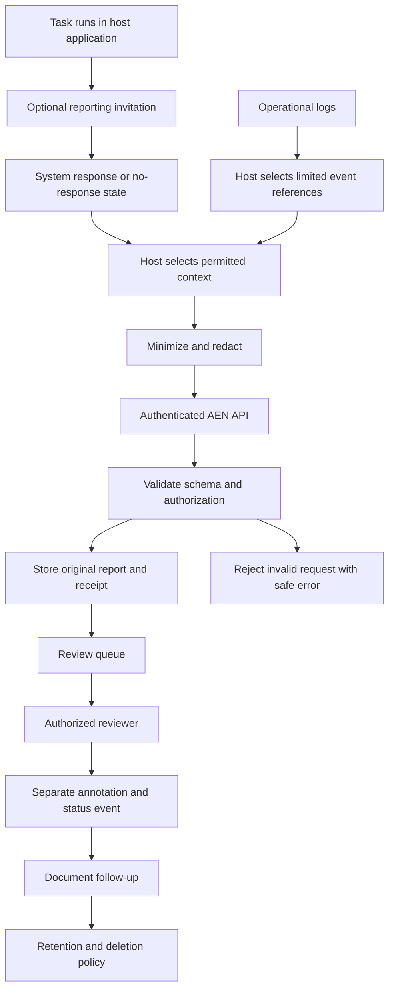

# AEN Data Flow

**Status:** Initial logical diagram; not a deployment design.

## Overview

The host application is the only component that can submit context it actually has and is authorized to share. AEN does not silently connect to a model provider's private conversation history merely because a host has an API key.

## Trust boundaries

1. **Task/model to host:** The host controls the prompt, tools, and context available to the model. The report may be influenced by these conditions.
2. **Host to AEN:** Only explicitly selected data should cross this boundary. The host must protect its credentials and remove unnecessary secrets.
3. **API to storage:** Validate input, enforce authorization, and avoid writing untrusted content into logs or executable contexts.
4. **Storage to reviewer:** Reviewers need scoped access. Original testimony must remain distinct from annotations.
5. **Review to action:** Reports must not trigger consequential actions automatically. A responsible process determines follow-up.
6. **Retention to deletion:** The retention policy must cover the primary store, logs, backups, and exports.

## Data boundaries

The first prototype should transmit:
- A pseudonymous host ID.
- A pseudonymous task ID.
- A minimal task summary, if needed.
- A model label only when known and appropriate.
- The original report text or an explicit response state.
- Optional, limited operational event references.
- The applicable retention policy version.

It should not transmit by default:
- Full transcripts.
- Hidden reasoning.
- API keys, passwords, or other credentials.
- Unrelated user records.
- Broad tool output or files.
- Raw logs containing sensitive data.

## Failure behavior

- If the host cannot obtain a response, represent that as a host/reporting failure state rather than claiming the system had nothing to report.
- If AEN rejects a request, return a safe, structured error without echoing sensitive input.
- If submission times out, use an idempotency key or equivalent mechanism to avoid accidental duplicate records.
- If a report cannot be routed, preserve its status and make the failure visible to the responsible operator.
- If a reviewer cannot reach a conclusion, record the uncertainty and what evidence was unavailable.

## Before deployment

This diagram is not sufficient to authorize a pilot. A real deployment still needs a selected stack, an actual threat model review, authorization tests, data retention and deletion behavior, operational ownership, and a clear disclosure to participants and operators.
